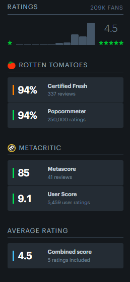
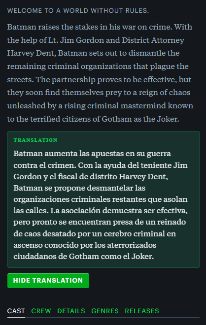

# Letterboxd Plus

[](https://github.com/NemoKing1210/letterboxd-plus/actions/workflows/ci.yml)
[](https://raw.githubusercontent.com/NemoKing1210/letterboxd-plus/main/letterboxd-plus.user.js)
[](https://github.com/NemoKing1210/letterboxd-plus/blob/main/LICENSE)

[English](https://github.com/NemoKing1210/letterboxd-plus/blob/main/README.md) · [Русский](https://github.com/NemoKing1210/letterboxd-plus/blob/main/README.ru.md) · [Español](https://github.com/NemoKing1210/letterboxd-plus/blob/main/README.es.md) · [Português (Brasil)](https://github.com/NemoKing1210/letterboxd-plus/blob/main/README.pt-BR.md) · **Deutsch** · [Français](https://github.com/NemoKing1210/letterboxd-plus/blob/main/README.fr.md) · [简体中文](https://github.com/NemoKing1210/letterboxd-plus/blob/main/README.zh-CN.md)

Ein schlankes Userscript, das [Letterboxd](https://letterboxd.com/) um externe
Filmwertungen, ausführlichere Besetzungs- und Crew-Listen, Hover-Minikarten und
Übersetzung direkt auf der Seite erweitert – ohne das vertraute Erscheinungsbild
der Website zu verändern.

Letterboxd Plus ergänzt Filmseiten um Wertungen von Rotten Tomatoes und
Metacritic, reichert Besetzung und Crew mit Porträts an, zeigt detaillierte
Minikarten für Filme und Mitglieder, übersetzt Inhaltsangaben, Rezensionen und
Kommentare und bietet ein Einstellungsfenster im Letterboxd-Stil. Es ist kein
API-Schlüssel nötig, und alles läuft in deinem Browser.

Kompatibel mit [Tampermonkey](https://www.tampermonkey.net/),
[Violentmonkey](https://violentmonkey.github.io/),
[Greasemonkey](https://www.greasespot.net/),
[ScriptCat](https://scriptcat.org/) und anderen Managern, die den
Metadatenblock `// ==UserScript==` unterstützen.

> **Status:** `0.23.1`. Enthält Wertungen, erweiterte Besetzung und Crew,
> Minikarten für Filme und Mitglieder, Übersetzung, Cache-Steuerung und eine
> Oberfläche in sieben Sprachen. Weitere Letterboxd-Verbesserungen können als
> unabhängige Module ergänzt werden.

> `@updateURL` / `@downloadURL` zeigen auf den GitHub-Branch `main` – die
> direkte Installations-URL unten liefert immer den neuesten Build.

## Screenshots

Das echte Userscript auf Live-Seiten von Letterboxd.


| | |
|---|---|
| <br>**Externe Wertungen** — Tomatometer, Popcornmeter, Metascore, User Score und ein kombinierter Durchschnitt | <br>**Erweiterte Besetzung** — Porträts, Namen und Rollen, geladen, sobald sich die Karten dem sichtbaren Bereich nähern |
| <br>**Erweiterte Crew** — dieselbe Darstellung für Regie, Produktion, Drehbuch und den Rest der Crew | <br>**Film-Minikarten** — Wertungen, Besetzung, Genres, Laufzeit, Inhaltsangabe, Schnelllinks und ein Übersetzen-Button beim Überfahren eines Posters |
| <br>**Mitglieder-Minikarten** — Level und Rangfortschritt, Statistiken, Ort, Favoriten und letzte Aktivität | <br>**Übersetzung** — Inhaltsangaben, Rezensionen und Kommentare, unter dem Original oder als Ersatz |

## Schnellinstallation

1. Installiere einen Userscript-Manager. Empfohlen sind Tampermonkey,
   Violentmonkey oder ScriptCat.
2. Öffne die direkte Userscript-URL unten.
3. Bestätige die Installation im Manager.

**Neuester GitHub-Build:**

```text
https://raw.githubusercontent.com/NemoKing1210/letterboxd-plus/main/letterboxd-plus.user.js
```

[](https://raw.githubusercontent.com/NemoKing1210/letterboxd-plus/main/letterboxd-plus.user.js)

### Installation über das Manager-Dashboard

| Manager | Installationspfad |
|---------|-------------------|
| Tampermonkey | Dashboard → **Utilities** → **Install from URL** |
| Violentmonkey | Dashboard → **+** → **Install from URL** |
| Greasemonkey | Add-on-Menü → **New User Script** → Skript einfügen |
| ScriptCat | Dashboard → Installation per URL, dann den GitHub-Direktlink einfügen |

### Manuelle Installation

1. Öffne
   [`letterboxd-plus.user.js`](https://github.com/NemoKing1210/letterboxd-plus/blob/main/letterboxd-plus.user.js)
   im Repository (oder führe nach dem Klonen `npm run build` aus).
2. Kopiere die vollständige Datei.
3. Erstelle ein neues Skript in deinem Userscript-Manager.
4. Füge die Datei ein, speichere sie und lade Letterboxd neu.

## Funktionen

### Externe Wertungen

Auf Filmseiten ergänzt das Skript kompakte Bereiche in der nativen
Seitenleiste:

- **Rotten Tomatoes** — Tomatometer-Kritikerwertung, Certified-Fresh-Status
  sofern verfügbar, optionale Popcornmeter-Publikumswertung, Anzahl der
  Kritiken und Publikumswertungen sowie ein direkter Link zur gefundenen
  Filmseite.
- **Metacritic** — Metascore mit Anzahl der Kritiken, optionaler User Score mit
  Anzahl der Wertungen, Farbakzente nach Punktbereich und ein direkter Link zum
  gefundenen Film.
- **Durchschnittliche Bewertung** — kombiniert die Letterboxd-Wertung mit allen
  aktivierten, verfügbaren externen Wertungen. Die Werte werden auf
  Letterboxds Fünf-Punkte-Skala normalisiert und gleich gewichtet gemittelt;
  nicht verfügbare Wertungen entfallen.

Beide Quellen nutzen Titel und Erscheinungsjahr zur eindeutigen Zuordnung, und
Letterboxds TMDB-ID dient als lokaler Cache-Schlüssel. Ladeskelette sowie
nicht blockierende Leer- und Fehlerzustände halten die Seite nutzbar, wenn eine
Quelle langsam oder nicht erreichbar ist.

### Erweiterte Besetzung und Crew

Der Bereich Besetzung kann kompakte Karten mit Porträt, Namen und Rolle jedes
Schauspielers anzeigen. Die Crew-Seite erhält dieselbe Darstellung für Regie,
Produktion, Drehbuch und weitere Crew-Mitglieder.

Porträts werden nur dann von öffentlichen Letterboxd-Personenseiten gelesen,
wenn sich die Karten dem sichtbaren Bereich nähern, mit einem kleinen
Anfragelimit. Zunächst erscheinen die ersten zehn Besetzungsmitglieder; der Rest
bleibt ungeladen, bis **Show All** gewählt und die Karten sichtbar werden.
Ergebnisse werden nur im Arbeitsspeicher gehalten.

### Film-Minikarten

Beim Überfahren eines Posters in Listen, im Katalog, Tagebuch, in Watchlists,
Suchergebnissen und Rasteransichten ähnlicher Filme öffnet sich eine kompakte
Minikarte mit:

- Poster, Titel, Jahr, Letterboxd-Community-Wertung und deinem Status
  (gesehen, geliked, Watchlist, Bewertung);
- Regie, Besetzung, Genre-Chips, Slogan, Laufzeit und einer kurzen
  Inhaltsangabe;
- Tomatometer- und Metascore-Marken, wenn diese Quellen aktiviert sind;
- Hinweisen zu Bewertungsstufen, Schnelllinks und einem direkten Link zum Film;
- einem **Übersetzen**-Button für die Inhaltsangabe.

Das Hauptposter einer Filmseite ist ausgenommen. Das Laden ist progressiv und
nicht blockierend, mit optionalem Vorladen beim Sichtbarwerden. Die Karte kann
je nach Einstellung beim Überfahren oder per Rechtsklick geöffnet werden.

### Mitglieder-Minikarten

Beim Überfahren eines Mitglieder-Avatars oder Profillinks an beliebiger Stelle
auf Letterboxd öffnet sich eine Mitglieder-Minikarte mit:

- Anzeigename, Benutzername, Avatar und Link zum vollständigen Profil;
- **Level und Rang** — Fortschrittsbalken mit Punkten und dem nächsten Rang;
- Statistiken zu Filmen, Filmen in diesem Jahr, Listen, Gefolgten und
  Followern;
- Bio, Ort, Lieblingsfilme und letzte Aktivität, wenn das Profil sie
  veröffentlicht.

Die Karte wird in der Website-Kopfzeile und innerhalb anderer Minikarten
übersprungen. Wie Filmkarten kann sie beim Überfahren oder per Rechtsklick
öffnen und beim Annähern der Avatare an den sichtbaren Bereich vorgeladen
werden.

### Übersetzung

Die integrierte Übersetzung kann übersetzen:

- **Filminhaltsangaben** auf Filmseiten und in Film-Minikarten;
- **Rezensionen** in Rezensionskarten und auf eigenständigen Rezensionsseiten;
- **Kommentare** unter Rezensionen.

Das Ziel ist eine der sieben Oberflächensprachen oder die Oberflächensprache
selbst. Wähle, ob der übersetzte Text das Original **ersetzt** (mit
Zurückschalten) oder **darunter** erscheint. Rezensionen können beim
Scrollen auch automatisch übersetzt werden; standardmäßig aus.

Die Übersetzung nutzt den kostenlosen Google-Endpunkt – ohne API-Schlüssel.
Jeder Block hat einen eigenen Übersetzen-Button, und jeder Bereich lässt sich in
den Einstellungen abschalten.

### Einstellungen

Öffne **Letterboxd Plus** über:

- das Letterboxd-Kontomenü direkt nach dem nativen Eintrag **Settings**
  (im Markengrün hervorgehoben);
- das Menü des Userscript-Managers über **Letterboxd Plus settings**.

Das barrierefreie Fenster mit Tabs folgt der visuellen Sprache von Letterboxd
und enthält:

- **Allgemein** — Oberflächensprache und Position der Hinweise;
- **Film** — Sichtbarkeit der Wertungsquellen, erweiterte Besetzung und Crew,
  Verhalten und Inhalt der Film-Minikarten;
- **Benutzerkarte** — Verhalten und Inhalt der Mitglieder-Minikarten;
- **Übersetzung** — Zielsprache, Anzeigemodus und Übersetzungsbereiche;
- **Cache** — Speicheranzeige, Statistiken pro Typ, Aufbewahrung,
  Cache-Schalter pro Quelle und manuelle Bereinigung;
- **Über** — Projektbeschreibung, Version, Lizenz, Repository und Autor.

Der Dialog unterstützt Tastaturnavigation durch die Tabs, Pfeiltasten,
Schließen mit Escape, sichtbaren Fokus, mobile Layouts und reduzierte
Bewegung.

### Oberflächensprachen

Die Oberfläche ist in sieben Sprachen verfügbar:

- English;
- Русский;
- Español;
- Português (Brasil);
- Deutsch;
- Français;
- 简体中文.

Der Standardmodus **Auto** prüft die bevorzugten Sprachen des Browsers und
wählt die erste unterstützte. Regionale Varianten wie `es-MX`, `pt-PT` und
`zh-Hans` werden der entsprechenden verfügbaren Übersetzung zugeordnet.
Nicht unterstützte oder fehlende Browsersprachen fallen auf Englisch zurück.
Eine feste Sprache lässt sich unter **Settings → General → Interface language**
wählen.

### Cache und Ausfallsicherheit

- Erfolgreiche Antworten von Rotten Tomatoes und Metacritic werden im
  Userscript-Speicher unter getrennten Quellenschlüsseln zwischengespeichert.
- Film- und Mitglieder-Minikarten sowie Übersetzungen nutzen eigene
  Cache-Schlüssel; jeder Typ lässt sich im Cache-Tab abschalten.
- Die Cache-Dauer ist von `0` bis `168` Stunden einstellbar.
- Bei `0` werden immer frische Daten angefordert.
- Der Cache-Tab zeigt die aktuelle Nutzung gegenüber einem vorsichtigen
  Richtwert von 5 MB.
- Aktive und abgelaufene Einträge werden getrennt gemessen und lassen sich pro
  Typ löschen, ohne Einstellungen zurückzusetzen.
- Anfragen haben ein festes Timeout, und Fehler verhindern nie das Laden von
  Letterboxd.
- Fehlgeschlagene Anfragen und fehlende Treffer werden nicht als gültige
  Wertungen gespeichert.

## Unterstützte Seiten

| Website | URL-Muster | Verhalten |
|---------|------------|-----------|
| Letterboxd | `https://letterboxd.com/*` | Einstellungseintrag in der Navigation, Wertungen, Besetzung und Crew, Minikarten und Übersetzung |
| Letterboxd (`www`) | `https://www.letterboxd.com/*` | Gleiches Verhalten auf dem alternativen Host |

Wertungen werden nur eingebunden, wenn die Seite Film-Metadaten über
`body[data-type="film"][data-tmdb-id]` bereitstellt.

## So funktioniert es

```text
Letterboxd-Filmseite
        │
        ├── Titel, Jahr und TMDB-ID aus den Seitenmetadaten lesen
        │
        ├── GM-gestützten Cache prüfen
        │
        ├── Rotten-Tomatoes-Suche und Scorecard
        │
        └── Metacritic-JSON-Suche und Filmdetail
                    │
                    ├── Titel und Erscheinungsjahr streng abgleichen
                    ├── Kritiker- und Publikumswertungen lesen
                    └── jede Quelle separat zwischenspeichern
                                      │
                                      ▼
                            in der Letterboxd-Seitenleiste rendern
```

Minikarten fordern die öffentliche Film- oder Mitgliederseite über
Same-Origin-Browseranfragen an und lesen die dort bereits vorhandenen Daten.
Der Seitenscanner ist idempotent und beobachtet dynamische DOM-Änderungen, sodass
React-Navigation den Kontomenü-Eintrag und die Einbindungen ohne Duplikate
wiederherstellt.

## Datenquellen und Einschränkungen

Rotten Tomatoes und Metacritic bieten für diesen Anwendungsfall keine
unterstützten öffentlichen APIs. Letterboxd Plus liest öffentliche
Rotten-Tomatoes-Seiten und die JSON-Endpunkte der Metacritic-Website über
`GM_xmlhttpRequest`.

Erweiterte Besetzung und Crew lesen öffentliche Letterboxd-Personenseiten über
Same-Origin-Browseranfragen und zeigen die dort bereits vorhandene Porträt-URL.
Ergebnisse werden nur im Arbeitsspeicher gehalten; Biografien und Porträts
werden nicht gespeichert.

Die Übersetzung sendet den ausgewählten Text an den öffentlichen
Google-Endpunkt. Übersetzter Text wird lokal im Userscript-Speicher
zwischengespeichert, sofern der Übersetzungs-Cache nicht abgeschaltet ist.

Daraus ergeben sich einige praktische Folgen:

- Änderungen am Markup oder JSON-Schema der Quellen können die
  Wertungsextraktion vorübergehend brechen;
- für einige neue, unbekannte oder unveröffentlichte Titel gibt es
  möglicherweise keine passende Seite;
- ein Titel kann ohne Kritiker- oder Publikumswertungen existieren;
- die Verfügbarkeit kann je nach Netzwerk oder Region variieren.

Diese Fälle werden als eingeschränkte Funktionalität behandelt, nicht als
Fehler der Letterboxd-Seite. Das Skript sendet keine Wertungen, ändert keine
Rotten-Tomatoes- oder Metacritic-Daten und benötigt keine Kontozugangsdaten.

## Aktualisierungen

Die Userscript-Metadaten enthalten `@updateURL` und `@downloadURL`, die auf das
GitHub-Artefakt in `main` zeigen. Kompatible Manager können daher automatisch
nach neuen Versionen suchen.

So veröffentlichst du eine Version:

1. Wähle den Semantic-Versioning-Schritt:
   - **major** für inkompatible oder migrationspflichtige Änderungen;
   - **minor** für rückwärtskompatible Funktionen;
   - **patch** für Korrekturen, Styling, Dokumentation und Wartung.
2. Synchronisiere die Version in `package.json` und `package-lock.json`.
3. Führe `npm run ci` aus, um die Root-Artefakte neu zu bauen und zu prüfen.
4. Lade den aktualisierten Quellcode und die generierten Dateien hoch.

## Repository-Struktur

```text
letterboxd-plus/
├── src/
│   ├── main.js                       # Start und DOM-Beobachter
│   ├── core/                         # Konstanten, Cache und Einstellungen
│   ├── api/                          # Letterboxd, RT, Metacritic und Übersetzung
│   ├── features/                     # Wertungen, Besetzung, Crew, Karten,
│   │                                 # Einstellungen, Übersetzung und Hinweise
│   ├── i18n/                         # Locales und Übersetzungshelfer
│   ├── utils/                        # Debounce, HTML-Escaping, Benutzernamen
│   └── styles/tokens.css             # Gemeinsame Design-Tokens
├── docs/
│   ├── letterboxd-dom/               # Stabile Selektoren und Datenkarten
│   └── screenshots/                  # README-Screenshots
├── scripts/                          # Kopieren und Prüfen von Artefakten
├── .github/workflows/ci.yml          # Build und Artefaktprüfung
├── letterboxd-plus.user.js           # Installierbares generiertes Userscript
├── letterboxd-plus.meta.js           # Generierte Metadaten für Updates
├── vite.config.js                    # Build und Userscript-Metadaten
├── package.json                      # Version, Abhängigkeiten und npm-Skripte
├── AGENTS.md / DESIGN.md / CLAUDE.md # Dokumentation für Mitwirkende und Agenten
├── SECURITY.md                       # Sicherheitsrichtlinie
├── README.md / README.*.md           # README in mehreren Sprachen
└── LICENSE                           # MIT-Lizenz
```

| Pfad | Zweck |
|------|-------|
| `src/` | Lesbare Quelle; Produktänderungen erfolgen hier |
| `dist/` | Lokale Vite-Ausgabe; generiert und von git ignoriert |
| `letterboxd-plus.user.js` | Vollständiges Installations- und Update-Artefakt |
| `letterboxd-plus.meta.js` | Leichtgewichtige Metadaten für Update-Prüfungen |
| `vite.config.js` | `@match`, `@connect`, Namen, URLs und Build-Konfiguration |

## Skript-Metadaten und Berechtigungen

| Feld | Wert |
|------|------|
| `@namespace` | `https://github.com/NemoKing1210/letterboxd-plus` |
| `@match` | Letterboxd-Haupt- und `www`-Host |
| `@connect` | Rotten-Tomatoes-Hosts, `backend.metacritic.com` und `translate.googleapis.com` |
| `@run-at` | `document-idle` |
| `@license` | MIT |
| `@updateURL` / `@downloadURL` | GitHub-Rohdatei des Userscripts in `main` |

| Berechtigung | Zweck |
|--------------|-------|
| `GM_xmlhttpRequest` | Externe Wertungsquellen und den Übersetzungs-Endpunkt anfragen |
| `GM_getValue` / `GM_setValue` | Einstellungen, Wertungs-Cache und Übersetzungen speichern |
| `GM_listValues` / `GM_deleteValue` | Cache-Einträge messen und löschen |
| `GM_addStyle` | Gebündelte Oberflächenstile einfügen |
| `GM_registerMenuCommand` | Einstellungen aus dem Userscript-Manager öffnen |

Es werden keine Zugriffstoken, API-Schlüssel, Passwörter oder
Letterboxd-Sitzungsdaten gespeichert.

## Entwicklung

Erfordert [Node.js 22](https://nodejs.org/), wie in
[`.nvmrc`](https://github.com/NemoKing1210/letterboxd-plus/blob/main/.nvmrc)
angegeben.

```bash
npm install
npm run dev                # Installierbares "dev:"-Userscript ausliefern
npm run build              # dist/ bauen und Root-Artefakte aktualisieren
npm run verify:artifacts   # Prüfen, ob dist und Root identisch sind
npm run ci                 # Bauen und alle Repository-Prüfungen ausführen
```

Bearbeite Quelldateien unter `src/`. Die Userscript-Metadaten stehen in
[`vite.config.js`](https://github.com/NemoKing1210/letterboxd-plus/blob/main/vite.config.js),
die Version kommt aus
[`package.json`](https://github.com/NemoKing1210/letterboxd-plus/blob/main/package.json).

Nach jeder Änderung:

1. Version nach Semantic Versioning aktualisieren;
2. `npm run ci` ausführen;
3. die neu erzeugten Artefakte `.user.js` und `.meta.js` einbeziehen.

Bearbeite minifizierte Artefakte nicht direkt und committe keine temporären
Localhost-Update-URLs.

Siehe auch:

- [`AGENTS.md`](https://github.com/NemoKing1210/letterboxd-plus/blob/main/AGENTS.md) — Architektur für KI-Agenten
- [`DESIGN.md`](https://github.com/NemoKing1210/letterboxd-plus/blob/main/DESIGN.md) — visuelle Sprache und Letterboxd-Tokens
- [`docs/letterboxd-dom/`](https://github.com/NemoKing1210/letterboxd-plus/blob/main/docs/letterboxd-dom/README.md) — stabile Selektoren und Datenkarten
- [`SECURITY.md`](https://github.com/NemoKing1210/letterboxd-plus/blob/main/SECURITY.md) — Sicherheitslücken melden

## Zugehörigkeit

Letterboxd Plus ist ein unabhängiges Community-Projekt. Es ist **nicht mit
Letterboxd, Rotten Tomatoes, Metacritic, Fandango, Google oder deren
Eigentümern verbunden oder von ihnen unterstützt**. Alle Produktnamen und
Marken gehören ihren jeweiligen Eigentümern.

## Lizenz

[MIT](https://github.com/NemoKing1210/letterboxd-plus/blob/main/LICENSE) —
Copyright © 2026 NemoKing
