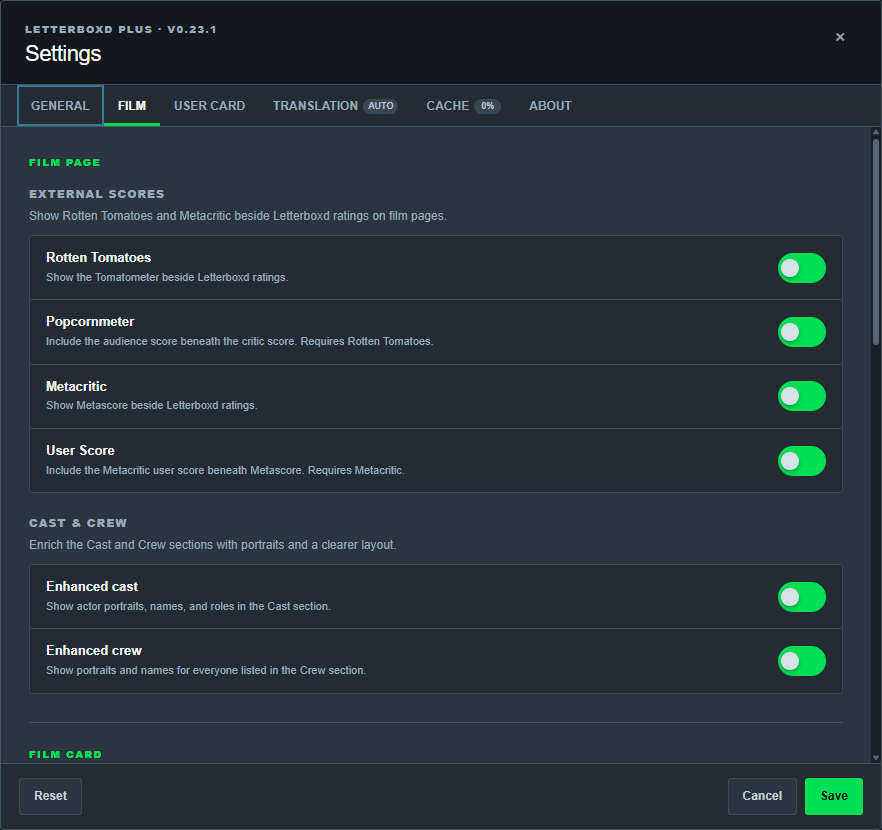
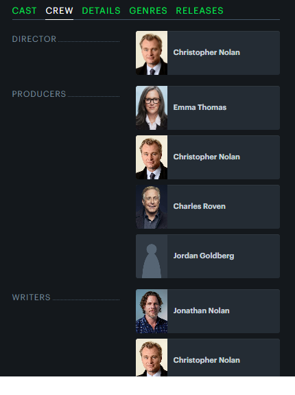
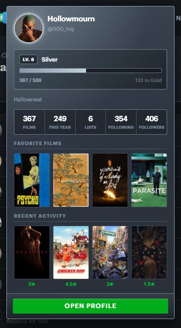

# Letterboxd Plus

[](https://github.com/NemoKing1210/letterboxd-plus/actions/workflows/ci.yml)
[](https://raw.githubusercontent.com/NemoKing1210/letterboxd-plus/main/letterboxd-plus.user.js)
[](https://github.com/NemoKing1210/letterboxd-plus/blob/main/LICENSE)

[English](https://github.com/NemoKing1210/letterboxd-plus/blob/main/README.md) · [Русский](https://github.com/NemoKing1210/letterboxd-plus/blob/main/README.ru.md) · [Español](https://github.com/NemoKing1210/letterboxd-plus/blob/main/README.es.md) · **Português (Brasil)** · [Deutsch](https://github.com/NemoKing1210/letterboxd-plus/blob/main/README.de.md) · [Français](https://github.com/NemoKing1210/letterboxd-plus/blob/main/README.fr.md) · [简体中文](https://github.com/NemoKing1210/letterboxd-plus/blob/main/README.zh-CN.md)

Um userscript leve que amplia o [Letterboxd](https://letterboxd.com/) com
avaliações externas, listas de elenco e equipe mais completas, mini cartões ao
passar o mouse e tradução na própria página — mantendo a familiaridade do site.

O Letterboxd Plus adiciona notas do Rotten Tomatoes e do Metacritic às páginas
de filmes, enriquece Elenco e Equipe com retratos, mostra mini cartões
detalhados de filmes e membros, traduz sinopses, resenhas e comentários e
oferece um painel de configurações com a aparência nativa do site. Não exige
chave de API e funciona inteiramente no navegador.

Compatível com [Tampermonkey](https://www.tampermonkey.net/),
[Violentmonkey](https://violentmonkey.github.io/),
[Greasemonkey](https://www.greasespot.net/),
[ScriptCat](https://scriptcat.org/) e outros gerenciadores que aceitam o bloco
de metadados `// ==UserScript==`.

> **Status:** `0.23.1`. Inclui avaliações, Elenco e Equipe aprimorados, mini
> cartões de filmes e membros, tradução, controle de cache e interface em sete
> idiomas. Novas melhorias do Letterboxd podem ser adicionadas como módulos
> independentes.

> `@updateURL` / `@downloadURL` apontam para a branch `main` do GitHub — o link
> direto de instalação abaixo sempre traz a compilação mais recente.

## Capturas de tela

O userscript real em páginas ativas do Letterboxd.



| | |
|---|---|
| <br>**Avaliações externas** — Tomatometer, Popcornmeter, Metascore, User Score e uma média combinada | <br>**Elenco aprimorado** — retratos, nomes e papéis, carregados conforme os cartões se aproximam da tela |
| <br>**Equipe aprimorada** — o mesmo tratamento para direção, produção, roteiro e o restante da equipe | <br>**Mini cartões de filmes** — notas, elenco, gêneros, duração, sinopse, links rápidos e botão de tradução ao passar o mouse |
| <br>**Mini cartões de membros** — nível e progresso, estatísticas, localização, favoritos e atividade recente | <br>**Tradução** — sinopses, resenhas e comentários, abaixo do original ou substituindo-o |

## Instalação rápida

1. Instale um gerenciador de userscripts. Recomendamos Tampermonkey,
   Violentmonkey ou ScriptCat.
2. Abra o link direto do userscript abaixo.
3. Confirme a instalação no gerenciador.

**Compilação mais recente no GitHub:**

```text
https://raw.githubusercontent.com/NemoKing1210/letterboxd-plus/main/letterboxd-plus.user.js
```

[](https://raw.githubusercontent.com/NemoKing1210/letterboxd-plus/main/letterboxd-plus.user.js)

### Instalar pelo painel do gerenciador

| Gerenciador | Caminho de instalação |
|-------------|-----------------------|
| Tampermonkey | Dashboard → **Utilities** → **Install from URL** |
| Violentmonkey | Dashboard → **+** → **Install from URL** |
| Greasemonkey | Menu da extensão → **New User Script** → cole o script |
| ScriptCat | Dashboard → instalar por URL e colar o link direto do GitHub |

### Instalação manual

1. Abra
   [`letterboxd-plus.user.js`](https://github.com/NemoKing1210/letterboxd-plus/blob/main/letterboxd-plus.user.js)
   no repositório (ou execute `npm run build` após clonar).
2. Copie o arquivo completo.
3. Crie um novo script no gerenciador de userscripts.
4. Cole o arquivo, salve e recarregue o Letterboxd.

## Recursos

### Avaliações externas

Nas páginas de filmes, o script adiciona seções compactas à barra lateral
nativa:

- **Rotten Tomatoes** — nota da crítica Tomatometer, status Certified Fresh
  quando disponível, nota opcional do público Popcornmeter, contagem de
  resenhas e avaliações e link direto para a página do filme encontrada.
- **Metacritic** — Metascore com contagem de resenhas da crítica, User Score
  opcional com contagem de avaliações, acentos por faixa de nota e link direto
  para o filme encontrado.
- **Média** — combina a nota do Letterboxd com todas as avaliações externas
  ativas e disponíveis. Os valores são normalizados para a escala de cinco
  pontos do Letterboxd e têm média igual; avaliações indisponíveis são
  ignoradas.

As duas fontes usam o título e o ano de lançamento para desambiguar resultados,
e o identificador TMDB do Letterboxd serve como chave de cache local. Esqueletos
de carregamento e estados não bloqueantes de vazio e erro mantêm a página
utilizável quando uma fonte demora ou falha.

### Elenco e equipe aprimorados

A seção Elenco pode mostrar cartões compactos com retrato, nome e papel de cada
ator. A página de Equipe recebe o mesmo tratamento para direção, produção,
roteiro e outros membros da equipe.

Os retratos são lidos de páginas públicas de pessoas do Letterboxd apenas
quando os cartões se aproximam da tela, com um limite de solicitações. Os dez
primeiros integrantes do elenco aparecem de início; o restante fica sem carregar
até **Show All** ser selecionado e os cartões se aproximarem da tela. Os
resultados ficam apenas na memória.

### Mini cartões de filmes

Ao passar o mouse em um pôster em listas, catálogo, diário, watchlist, busca e
grades de filmes semelhantes, abre-se um mini cartão com:

- pôster, título, ano, nota da comunidade do Letterboxd e seu status (assistido,
  curtido, watchlist, nota);
- direção, elenco, gêneros, slogan, duração e uma sinopse curta;
- selos de Tomatometer e Metascore quando essas fontes estão ativas;
- indicadores de nível de nota, links rápidos e link direto para o filme;
- um botão **Traduzir** para a sinopse.

O pôster principal da página do filme fica de fora. O carregamento é
progressivo e não bloqueante, com pré-carregamento opcional ao entrar na tela.
O cartão pode abrir ao passar o mouse ou com o botão direito, conforme sua
preferência.

### Mini cartões de membros

Ao passar o mouse no avatar ou no link de perfil de um membro em qualquer lugar
do Letterboxd, abre-se um mini cartão com:

- nome de exibição, nome de usuário, avatar e link para o perfil completo;
- **nível e categoria** — barra de progresso com pontos e a próxima categoria;
- estatísticas de filmes, filmes neste ano, listas, seguindo e seguidores;
- bio, localização, filmes favoritos e atividade recente quando o perfil os
  publica.

O cartão é ignorado no cabeçalho do site e dentro de outros mini cartões. Como os
de filmes, ele pode abrir ao passar o mouse ou com o botão direito e
pré-carregar conforme os avatares se aproximam da tela.

### Tradução

A tradução integrada pode traduzir:

- **sinopses de filmes** nas páginas de filmes e nos mini cartões;
- **resenhas** em cartões de resenha e páginas de resenha independentes;
- **comentários** abaixo das resenhas.

O destino é um dos sete idiomas da interface ou o mesmo idioma da interface.
Escolha se o texto traduzido **substitui** o original (com botão para voltar) ou
aparece **abaixo**. As resenhas também podem ser traduzidas automaticamente ao
entrar na tela; desativado por padrão.

A tradução usa o endpoint gratuito do Google — sem chave de API. Cada bloco tem
seu botão Traduzir e cada escopo pode ser desativado nas configurações.

### Configurações

Abra o **Letterboxd Plus**:

- no menu suspenso da conta do Letterboxd, logo após o item nativo **Settings**
  (destacado no verde da marca);
- no menu do gerenciador de userscripts em **Letterboxd Plus settings**.

O painel acessível com abas segue a linguagem visual do Letterboxd e inclui:

- **Geral** — idioma da interface e posição dos avisos;
- **Filme** — visibilidade das fontes de avaliação, Elenco e Equipe aprimorados,
  comportamento e conteúdo dos mini cartões de filmes;
- **Cartão do usuário** — comportamento e conteúdo dos mini cartões de membros;
- **Tradução** — idioma de destino, modo de exibição e escopos de tradução;
- **Cache** — medidor de armazenamento, estatísticas por tipo, retenção,
  chaves de cache por fonte e limpeza manual;
- **Sobre** — descrição do projeto, versão, licença, repositório e autor.

O diálogo oferece navegação por abas com teclado, setas, fechamento com Escape,
foco visível, layouts móveis e preferências de movimento reduzido.

### Idiomas da interface

A interface está disponível em sete idiomas:

- English;
- Русский;
- Español;
- Português (Brasil);
- Deutsch;
- Français;
- 简体中文.

O modo **Auto** padrão verifica a lista de idiomas preferidos do navegador e
escolhe o primeiro compatível. Variantes regionais como `es-MX`, `pt-PT` e
`zh-Hans` são mapeadas para a tradução disponível correspondente. Idiomas do
navegador não compatíveis ou ausentes voltam ao inglês. Você pode fixar um
idioma em **Settings → General → Interface language**.

### Cache e resiliência

- Respostas bem-sucedidas do Rotten Tomatoes e do Metacritic são armazenadas no
  storage do userscript com chaves separadas por fonte.
- Mini cartões de filmes e membros e traduções usam suas próprias chaves de
  cache, e cada tipo pode ser desativado na aba Cache.
- A duração do cache é configurável entre `0` e `168` horas.
- Com `0`, os dados são sempre solicitados novamente.
- A aba Cache mostra o uso atual diante de um orçamento orientativo e
  conservador de 5 MB.
- Entradas ativas e expiradas são medidas separadamente e podem ser limpas por
  tipo sem redefinir as configurações.
- As solicitações têm tempo limite fixo e erros nunca impedem o Letterboxd de
  carregar.
- Solicitações falhas e correspondências ausentes não são guardadas como
  avaliações válidas.

## Páginas compatíveis

| Site | Padrão de URL | Comportamento |
|------|---------------|----------------|
| Letterboxd | `https://letterboxd.com/*` | Item de configurações na navegação, avaliações, elenco e equipe, mini cartões e tradução |
| Letterboxd (`www`) | `https://www.letterboxd.com/*` | O mesmo comportamento no host alternativo |

As avaliações só são montadas quando a página expõe metadados de filme via
`body[data-type="film"][data-tmdb-id]`.

## Como funciona

```text
Página de filme do Letterboxd
        │
        ├── ler título, ano e TMDB ID dos metadados da página
        │
        ├── verificar o cache do GM
        │
        ├── busca e ficha do Rotten Tomatoes
        │
        └── busca JSON e ficha do Metacritic
                    │
                    ├── correspondência exata de título e ano
                    ├── ler notas da crítica e do público
                    └── guardar cada fonte separadamente
                                      │
                                      ▼
                            renderizar na barra lateral
```

Os mini cartões solicitam a página pública do filme ou do membro por meio de
requisições do navegador na mesma origem e leem os dados já presentes nela. O
scanner de página é idempotente e observa mudanças dinâmicas do DOM, então a
navegação do React restaura o item do menu da conta e as montagens sem criar
duplicatas.

## Fontes de dados e limitações

Rotten Tomatoes e Metacritic não oferecem APIs públicas compatíveis para este
caso de uso. O Letterboxd Plus lê páginas públicas do Rotten Tomatoes e os
endpoints JSON usados pelo próprio site do Metacritic via `GM_xmlhttpRequest`.

Elenco e Equipe aprimorados leem páginas públicas de pessoas do Letterboxd com
requisições do navegador na mesma origem e exibem a URL do retrato já fornecida
ali. Os resultados ficam apenas na memória; biografias e retratos não são
persistidos.

A tradução envia o texto selecionado para o endpoint público do Google. O texto
traduzido é armazenado localmente no storage do userscript, a menos que o cache
de traduções esteja desativado.

Isso tem várias consequências práticas:

- mudanças de marcação ou do esquema JSON das fontes podem quebrar
  temporariamente a extração de notas;
- alguns títulos novos, obscuros ou não lançados podem não ter página
  correspondente;
- um título pode existir sem notas da crítica ou do público;
- a disponibilidade pode variar conforme a rede ou a região.

Esses casos são tratados como funcionalidade reduzida, não como falhas da página
do Letterboxd. O script não envia avaliações, não modifica dados do Rotten
Tomatoes ou do Metacritic e não exige credenciais de conta.

## Atualizações

Os metadados do userscript incluem `@updateURL` e `@downloadURL` apontando para
o artefato direto do GitHub em `main`. Gerenciadores compatíveis podem procurar
novas versões automaticamente.

Para publicar uma versão:

1. Escolha o incremento de Versionamento Semântico:
   - **major** para mudanças incompatíveis ou que exijam migração;
   - **minor** para recursos compatíveis;
   - **patch** para correções, estilos, documentação e manutenção.
2. Sincronize a versão em `package.json` e `package-lock.json`.
3. Execute `npm run ci` para recompilar e verificar os artefatos raiz.
4. Envie o código atualizado e os arquivos gerados.

## Estrutura do repositório

```text
letterboxd-plus/
├── src/
│   ├── main.js                       # Inicialização e observador do DOM
│   ├── core/                         # Constantes, cache e configurações
│   ├── api/                          # Letterboxd, RT, Metacritic e tradução
│   ├── features/                     # Avaliações, elenco, equipe, cartões,
│   │                                 # configurações, tradução e avisos
│   ├── i18n/                         # Locales e auxiliares de tradução
│   ├── utils/                        # Debounce, escape HTML, nomes de usuário
│   └── styles/tokens.css             # Tokens de design compartilhados
├── docs/
│   ├── letterboxd-dom/               # Seletores estáveis e mapas de dados
│   └── screenshots/                  # Capturas para o README
├── scripts/                          # Cópia e verificação de artefatos
├── .github/workflows/ci.yml          # Compilação e verificação
├── letterboxd-plus.user.js           # Userscript instalável gerado
├── letterboxd-plus.meta.js           # Metadados gerados para atualizações
├── vite.config.js                    # Compilação e metadados do userscript
├── package.json                      # Versão, dependências e scripts npm
├── AGENTS.md / DESIGN.md / CLAUDE.md # Documentação para colaboradores e agentes
├── SECURITY.md                       # Política de segurança
├── README.md / README.*.md           # README em vários idiomas
└── LICENSE                           # Licença MIT
```

| Caminho | Propósito |
|---------|-----------|
| `src/` | Fonte legível; as mudanças de produto são feitas aqui |
| `dist/` | Saída local do Vite; gerada e ignorada pelo git |
| `letterboxd-plus.user.js` | Artefato completo de instalação e atualização |
| `letterboxd-plus.meta.js` | Metadados leves para verificar atualizações |
| `vite.config.js` | `@match`, `@connect`, nomes, URL e configuração de compilação |

## Metadados e permissões do script

| Campo | Valor |
|-------|-------|
| `@namespace` | `https://github.com/NemoKing1210/letterboxd-plus` |
| `@match` | Hosts principal e `www` do Letterboxd |
| `@connect` | Hosts do Rotten Tomatoes, `backend.metacritic.com` e `translate.googleapis.com` |
| `@run-at` | `document-idle` |
| `@license` | MIT |
| `@updateURL` / `@downloadURL` | Userscript direto do GitHub em `main` |

| Permissão | Propósito |
|-----------|-----------|
| `GM_xmlhttpRequest` | Solicitar fontes externas de avaliação e o endpoint de tradução |
| `GM_getValue` / `GM_setValue` | Guardar configurações, cache de avaliações e traduções |
| `GM_listValues` / `GM_deleteValue` | Medir e limpar entradas de cache |
| `GM_addStyle` | Injetar os estilos da interface |
| `GM_registerMenuCommand` | Abrir as configurações pelo gerenciador de userscripts |

Nenhum token de acesso, chave de API, senha ou dado de sessão do Letterboxd é
armazenado.

## Desenvolvimento

Requer [Node.js 22](https://nodejs.org/), conforme
[`.nvmrc`](https://github.com/NemoKing1210/letterboxd-plus/blob/main/.nvmrc).

```bash
npm install
npm run dev                # Serve um userscript "dev:" instalável
npm run build              # Compila dist/ e atualiza os artefatos raiz
npm run verify:artifacts   # Verifica se dist e a raiz são idênticos
npm run ci                 # Compila e executa todas as verificações
```

Edite os arquivos em `src/`. Os metadados do userscript são definidos em
[`vite.config.js`](https://github.com/NemoKing1210/letterboxd-plus/blob/main/vite.config.js)
e a versão vem de
[`package.json`](https://github.com/NemoKing1210/letterboxd-plus/blob/main/package.json).

Depois de cada mudança:

1. atualize a versão com Versionamento Semântico;
2. execute `npm run ci`;
3. inclua os artefatos regenerados `.user.js` e `.meta.js`.

Não edite diretamente os artefatos minificados e não faça commit de URLs
temporárias de localhost.

Veja também:

- [`AGENTS.md`](https://github.com/NemoKing1210/letterboxd-plus/blob/main/AGENTS.md) — arquitetura para agentes de IA
- [`DESIGN.md`](https://github.com/NemoKing1210/letterboxd-plus/blob/main/DESIGN.md) — linguagem visual e tokens do Letterboxd
- [`docs/letterboxd-dom/`](https://github.com/NemoKing1210/letterboxd-plus/blob/main/docs/letterboxd-dom/README.md) — seletores estáveis e mapas de dados
- [`SECURITY.md`](https://github.com/NemoKing1210/letterboxd-plus/blob/main/SECURITY.md) — como relatar uma vulnerabilidade

## Afiliação

O Letterboxd Plus é um projeto comunitário independente. **Não é afiliado nem
endossado pelo Letterboxd, Rotten Tomatoes, Metacritic, Fandango, Google ou seus
proprietários**. Todos os nomes de produtos e marcas pertencem aos seus
respectivos proprietários.

## Licença

[MIT](https://github.com/NemoKing1210/letterboxd-plus/blob/main/LICENSE) —
Copyright © 2026 NemoKing
