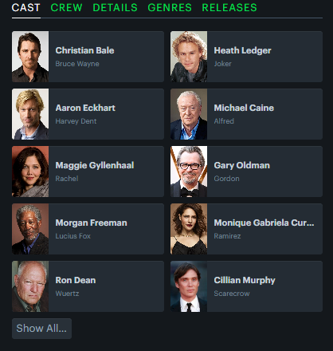
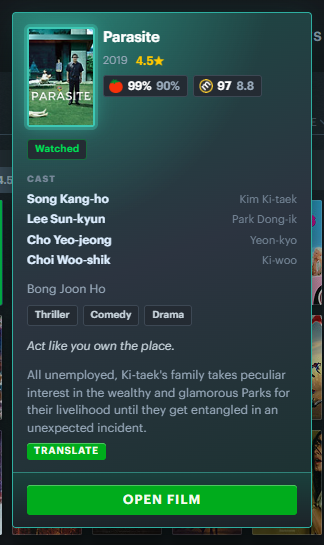

# Letterboxd Plus

[](https://github.com/NemoKing1210/letterboxd-plus/actions/workflows/ci.yml)
[](https://raw.githubusercontent.com/NemoKing1210/letterboxd-plus/main/letterboxd-plus.user.js)
[](https://github.com/NemoKing1210/letterboxd-plus/blob/main/LICENSE)

[English](https://github.com/NemoKing1210/letterboxd-plus/blob/main/README.md) · [Русский](https://github.com/NemoKing1210/letterboxd-plus/blob/main/README.ru.md) · [Español](https://github.com/NemoKing1210/letterboxd-plus/blob/main/README.es.md) · [Português (Brasil)](https://github.com/NemoKing1210/letterboxd-plus/blob/main/README.pt-BR.md) · [Deutsch](https://github.com/NemoKing1210/letterboxd-plus/blob/main/README.de.md) · [Français](https://github.com/NemoKing1210/letterboxd-plus/blob/main/README.fr.md) · **简体中文**

一个轻量级用户脚本，为 [Letterboxd](https://letterboxd.com/) 增加外部影片评分、更完整的演职员列表、悬停迷你卡片以及页面内翻译，同时不改变网站熟悉的观感。

Letterboxd Plus 在影片页面加入 Rotten Tomatoes 和 Metacritic 评分，为演员与剧组补充头像，显示影片和会员的详细迷你卡片，翻译简介、影评和评论，并提供 Letterboxd 风格的设置面板。无需 API 密钥，一切都在浏览器中运行。

兼容 [Tampermonkey](https://www.tampermonkey.net/)、
[Violentmonkey](https://violentmonkey.github.io/)、
[Greasemonkey](https://www.greasespot.net/)、
[ScriptCat](https://scriptcat.org/) 以及其他支持 `// ==UserScript==` 元数据块的用户脚本管理器。

> **状态：** `0.23.1`。包含评分、增强演职员、影片与会员迷你卡片、翻译、缓存控制以及七种界面语言。后续的 Letterboxd 增强功能可以作为独立模块添加。

> `@updateURL` / `@downloadURL` 指向 GitHub 的 `main` 分支 —— 下方的直接安装链接始终提供最新版本。

## 截图

真实用户脚本在实时 Letterboxd 页面上的效果。


| | |
|---|---|
| <br>**外部评分** — 烂番茄新鲜度、爆米花指数、Metascore、用户评分以及综合平均分 | <br>**增强演员列表** — 头像、姓名和角色，在卡片接近可视区域时加载 |
| <br>**增强剧组** — 导演、制片、编剧及其他剧组成员采用相同呈现方式 | <br>**影片迷你卡片** — 悬停海报时显示评分、演员、类型、片长、简介、快捷链接和翻译按钮 |
| <br>**会员迷你卡片** — 等级与晋级进度、统计、地点、收藏和最近活动 | <br>**翻译** — 简介、影评和评论，可显示在原文下方或替换原文 |

## 快速安装

1. 安装用户脚本管理器。推荐 Tampermonkey、Violentmonkey 或 ScriptCat。
2. 打开下方的用户脚本直链。
3. 在管理器中确认安装。

**最新 GitHub 版本：**

```text
https://raw.githubusercontent.com/NemoKing1210/letterboxd-plus/main/letterboxd-plus.user.js
```

[](https://raw.githubusercontent.com/NemoKing1210/letterboxd-plus/main/letterboxd-plus.user.js)

### 通过管理器仪表盘安装

| 管理器 | 安装路径 |
|--------|----------|
| Tampermonkey | 仪表盘 → **实用工具** → **从 URL 安装** |
| Violentmonkey | 仪表盘 → **+** → **从 URL 安装** |
| Greasemonkey | 扩展菜单 → **新建用户脚本** → 粘贴脚本 |
| ScriptCat | 仪表盘 → 通过 URL 安装，然后粘贴 GitHub 直链 |

### 手动安装

1. 在仓库中打开
   [`letterboxd-plus.user.js`](https://github.com/NemoKing1210/letterboxd-plus/blob/main/letterboxd-plus.user.js)
   （或在克隆后运行 `npm run build`）。
2. 复制完整文件。
3. 在用户脚本管理器中新建脚本。
4. 粘贴文件、保存并重新加载 Letterboxd。

## 功能

### 外部评分

在影片页面，脚本会在原生侧栏中加入紧凑区块：

- **Rotten Tomatoes** — 影评人新鲜度评分、可用时的 Certified Fresh 状态、可选的观众爆米花指数、影评与观众评分数量，以及指向所匹配影片页面的直接链接。
- **Metacritic** — 带影评数量的 Metascore、可选的带评分数量的用户评分、按分数区间变化的颜色强调，以及指向所匹配影片的直接链接。
- **综合评分** — 将 Letterboxd 评分与所有已启用且可用的外部评分合并。数值会归一化到 Letterboxd 的五星制，然后等权平均；不可用的评分会被跳过。

两个数据源都使用片名和上映年份进行精确匹配，Letterboxd 的 TMDB ID 用作本地缓存键。加载骨架以及不会阻塞页面的空状态和错误状态，确保某个数据源缓慢或无法访问时页面仍然可用。

### 增强演员与剧组

演员区块可以显示紧凑卡片，包含每位演员的头像、姓名和角色。剧组页面则对导演、制片、编剧和其他剧组成员采用相同呈现方式。

只有在卡片接近可视区域时才会从 Letterboxd 公开的人物页面读取头像，并限制请求频率。首先显示前十位演员；其余内容在点击 **Show All** 并且卡片进入可视区域后才加载。结果仅保存在内存中。

### 影片迷你卡片

在列表、目录、日记、待看清单、搜索结果和相似影片网格中悬停海报时，会打开一张紧凑的迷你卡片，其中包含：

- 海报、片名、年份、Letterboxd 社区评分以及你的状态（已看、喜欢、待看、评分）；
- 导演、演员、类型标签、宣传语、片长和简短简介；
- 启用相应数据源后显示的新鲜度和 Metascore 标记；
- 评分区间提示、快捷链接以及影片直链；
- 简介的**翻译**按钮。

影片页面的主海报会被排除。加载是渐进式且非阻塞的，可选在进入可视区域时预加载。根据设置，卡片可以在悬停或右键时打开。

### 会员迷你卡片

在 Letterboxd 任意位置悬停会员头像或个人资料链接时，会打开会员迷你卡片，其中包含：

- 显示名称、用户名、头像以及完整个人资料链接；
- **等级与段位** — 带积分和下一段位的进度条；
- 影片、今年影片、清单、关注和粉丝统计；
- 个人资料公开时的简介、地点、最爱影片和最近活动。

网站页眉内以及其他迷你卡片内部会跳过该卡片。与影片卡片一样，它可以在悬停或右键时打开，并可在头像接近可视区域时预加载。

### 翻译

内置翻译可以翻译：

- 影片页面和影片迷你卡片中的**影片简介**；
- 影评卡片和独立影评页面中的**影评**；
- 影评下方的**评论**。

目标语言可以是七种界面语言之一，也可以与界面语言相同。可选择译文**替换**原文（并可切回），或显示在**原文下方**。影评也可以在滚动时自动翻译；默认关闭。

翻译使用免费的 Google 公共端点 —— 无需 API 密钥。每个区块都有独立的翻译按钮，每一类都可以在设置中关闭。

### 设置

可通过以下方式打开 **Letterboxd Plus**：

- Letterboxd 账户菜单，紧随原生 **Settings** 项之后（以品牌绿色高亮）；
- 用户脚本管理器的菜单，选择 **Letterboxd Plus settings**。

可访问的标签式对话框遵循 Letterboxd 的视觉语言，包含：

- **常规** — 界面语言和提示位置；
- **影片** — 评分源可见性、增强演员与剧组、影片迷你卡片的行为和内容；
- **用户卡片** — 会员迷你卡片的行为和内容；
- **翻译** — 目标语言、显示模式和被翻译的区块；
- **缓存** — 存储用量、按类型统计、保留时长、各数据源缓存开关和手动清理；
- **关于** — 项目说明、版本、许可证、仓库和作者。

该对话框支持标签页键盘导航、方向键、Esc 关闭、可见焦点、移动端布局以及减少动态效果。

### 界面语言

界面提供七种语言：

- English；
- Русский；
- Español；
- Português (Brasil)；
- Deutsch；
- Français；
- 简体中文。

默认的 **Auto** 模式会检查浏览器的首选语言，并选择第一个受支持的语言。`es-MX`、`pt-PT` 和 `zh-Hans` 等地区变体会映射到对应的可用翻译。不支持或缺失的浏览器语言会回退到英语。也可以在 **Settings → General → Interface language** 中固定选择语言。

### 缓存与容错

- Rotten Tomatoes 和 Metacritic 的成功响应会以独立的数据源键缓存在用户脚本存储中。
- 影片和会员迷你卡片以及翻译使用各自的缓存键；每种类型都可以在缓存标签页中关闭。
- 缓存时长可在 `0` 到 `168` 小时之间调整。
- 设为 `0` 时始终请求最新数据。
- 缓存标签页显示当前用量，并与保守的 5 MB 参考值对比。
- 有效和过期条目分别统计，可按类型清除而不会重置设置。
- 请求设有固定超时，错误绝不会阻止 Letterboxd 加载。
- 失败的请求和未匹配的结果不会作为有效评分缓存。

## 支持的页面

| 网站 | URL 模式 | 行为 |
|------|----------|------|
| Letterboxd | `https://letterboxd.com/*` | 导航中的设置入口、评分、演员与剧组、迷你卡片和翻译 |
| Letterboxd（`www`） | `https://www.letterboxd.com/*` | 在备用主机上行为相同 |

只有当页面通过 `body[data-type="film"][data-tmdb-id]` 提供影片元数据时，才会注入评分。

## 工作原理

```text
Letterboxd 影片页面
        │
        ├── 从页面元数据读取片名、年份和 TMDB ID
        │
        ├── 检查由 GM 管理的缓存
        │
        ├── Rotten Tomatoes 搜索与评分卡
        │
        └── Metacritic JSON 搜索与影片详情
                    │
                    ├── 严格匹配片名和上映年份
                    ├── 读取影评人和观众评分
                    └── 分别缓存每个数据源
                                      │
                                      ▼
                            渲染到 Letterboxd 侧栏
```

迷你卡片通过同源浏览器请求获取公开的影片或会员页面，并读取页面中已有的数据。页面扫描器是幂等的，并会观察动态 DOM 变化，因此 React 导航恢复账户菜单项和注入内容时不会产生重复。

## 数据源与限制

Rotten Tomatoes 和 Metacritic 不为这种用途提供受支持的公共 API。Letterboxd Plus 通过 `GM_xmlhttpRequest` 读取公开的 Rotten Tomatoes 页面和 Metacritic 网站的 JSON 端点。

增强演员与剧组通过同源浏览器请求读取 Letterboxd 公开的人物页面，并显示页面中已有的头像 URL。结果仅保存在内存中；传记和头像不会被存储。

翻译会把所选文本发送到 Google 的公共端点。除非关闭翻译缓存，译文会缓存在用户脚本的本地存储中。

这带来一些实际影响：

- 数据源的标记或 JSON 结构变化可能暂时破坏评分提取；
- 一些新片、冷门片或未上映影片可能没有匹配页面；
- 影片可能存在但没有影评人或观众评分；
- 可用性可能因网络或地区而异。

这些情况会被视为功能降级，而不是 Letterboxd 页面的错误。脚本不会提交评分、不会修改 Rotten Tomatoes 或 Metacritic 数据，也不需要任何账户凭据。

## 更新

用户脚本元数据包含指向 `main` 分支 GitHub 产物的 `@updateURL` 和 `@downloadURL`。兼容的管理器因此可以自动检查新版本。

发布版本时：

1. 选择语义化版本递增：
   - **主版本**用于不兼容或需要迁移的变更；
   - **次版本**用于向后兼容的新功能；
   - **修订版本**用于修复、样式、文档和维护。
2. 在 `package.json` 和 `package-lock.json` 中同步版本。
3. 运行 `npm run ci` 重建并校验根目录产物。
4. 上传更新后的源代码和生成文件。

## 仓库结构

```text
letterboxd-plus/
├── src/
│   ├── main.js                       # 启动与 DOM 观察器
│   ├── core/                         # 常量、缓存和设置
│   ├── api/                          # Letterboxd、RT、Metacritic 和翻译
│   ├── features/                     # 评分、演员、剧组、卡片、
│   │                                 # 设置、翻译和提示
│   ├── i18n/                         # 语言包和翻译辅助
│   ├── utils/                        # 防抖、HTML 转义、用户名
│   └── styles/tokens.css             # 共享设计令牌
├── docs/
│   ├── letterboxd-dom/               # 稳定选择器和数据说明
│   └── screenshots/                  # README 截图
├── scripts/                          # 产物复制与校验
├── .github/workflows/ci.yml          # 构建与产物校验
├── letterboxd-plus.user.js           # 生成的可安装用户脚本
├── letterboxd-plus.meta.js           # 生成的更新元数据
├── vite.config.js                    # 构建与用户脚本元数据
├── package.json                      # 版本、依赖和 npm 脚本
├── AGENTS.md / DESIGN.md / CLAUDE.md # 贡献者与代理文档
├── SECURITY.md                       # 安全政策
├── README.md / README.*.md           # 多语言 README
└── LICENSE                           # MIT 许可证
```

| 路径 | 用途 |
|------|------|
| `src/` | 可读源码；所有产品修改都在这里进行 |
| `dist/` | 本地 Vite 输出；由构建生成并被 git 忽略 |
| `letterboxd-plus.user.js` | 完整的安装和更新产物 |
| `letterboxd-plus.meta.js` | 用于更新检查的轻量元数据 |
| `vite.config.js` | `@match`、`@connect`、名称、URL 和构建配置 |

## 脚本元数据与权限

| 字段 | 值 |
|------|-----|
| `@namespace` | `https://github.com/NemoKing1210/letterboxd-plus` |
| `@match` | Letterboxd 主站和 `www` 主机 |
| `@connect` | Rotten Tomatoes 主机、`backend.metacritic.com` 和 `translate.googleapis.com` |
| `@run-at` | `document-idle` |
| `@license` | MIT |
| `@updateURL` / `@downloadURL` | `main` 分支中的 GitHub 用户脚本原始文件 |

| 权限 | 用途 |
|------|------|
| `GM_xmlhttpRequest` | 请求外部评分源和翻译端点 |
| `GM_getValue` / `GM_setValue` | 存储设置、评分缓存和翻译 |
| `GM_listValues` / `GM_deleteValue` | 统计和清除缓存条目 |
| `GM_addStyle` | 注入打包的界面样式 |
| `GM_registerMenuCommand` | 从用户脚本管理器打开设置 |

不会存储任何访问令牌、API 密钥、密码或 Letterboxd 会话数据。

## 开发

需要 [Node.js 22](https://nodejs.org/)，如
[`.nvmrc`](https://github.com/NemoKing1210/letterboxd-plus/blob/main/.nvmrc) 所示。

```bash
npm install
npm run dev                # 提供可安装的 "dev:" 用户脚本
npm run build              # 构建 dist/ 并刷新根目录产物
npm run verify:artifacts   # 校验 dist 和根目录是否一致
npm run ci                 # 构建并运行所有仓库检查
```

在 `src/` 下编辑源文件。用户脚本元数据位于
[`vite.config.js`](https://github.com/NemoKing1210/letterboxd-plus/blob/main/vite.config.js)，
版本来自
[`package.json`](https://github.com/NemoKing1210/letterboxd-plus/blob/main/package.json)。

每次修改后：

1. 按语义化版本更新版本号；
2. 运行 `npm run ci`；
3. 包含重新生成的 `.user.js` 和 `.meta.js` 产物。

不要直接编辑压缩后的产物，也不要提交临时的本地更新 URL。

另请参阅：

- [`AGENTS.md`](https://github.com/NemoKing1210/letterboxd-plus/blob/main/AGENTS.md) — 面向 AI 代理的架构说明
- [`DESIGN.md`](https://github.com/NemoKing1210/letterboxd-plus/blob/main/DESIGN.md) — 视觉语言和 Letterboxd 设计令牌
- [`docs/letterboxd-dom/`](https://github.com/NemoKing1210/letterboxd-plus/blob/main/docs/letterboxd-dom/README.md) — 稳定选择器和数据说明
- [`SECURITY.md`](https://github.com/NemoKing1210/letterboxd-plus/blob/main/SECURITY.md) — 报告漏洞

## 归属声明

Letterboxd Plus 是一个独立的社区项目。它与 **Letterboxd、Rotten Tomatoes、Metacritic、Fandango、Google 或其所有者没有任何关联、认可或赞助关系**。所有产品名称和商标均归各自所有者所有。

## 许可证

[MIT](https://github.com/NemoKing1210/letterboxd-plus/blob/main/LICENSE) —
Copyright © 2026 NemoKing
